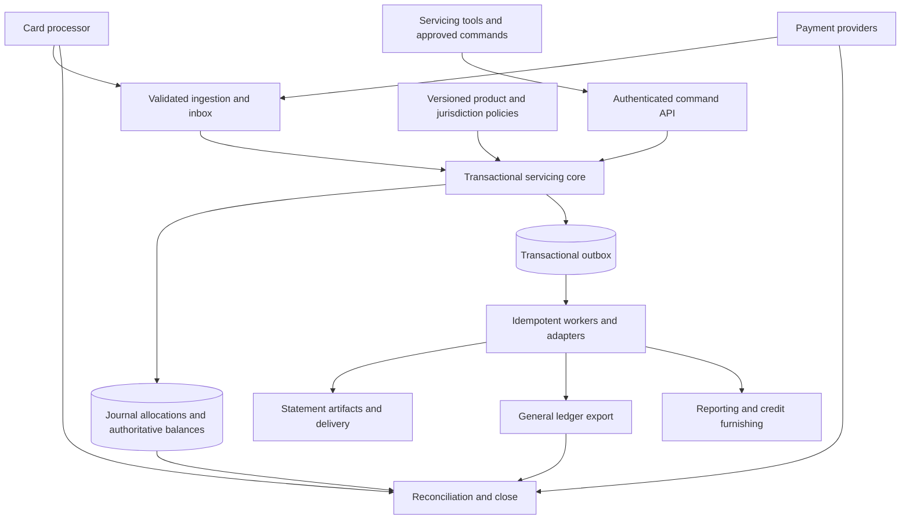

# Credit Card Receivables Subledger

## Initial requirements and architecture

Version 0.1 • October 19, 2026 • Proposed baseline for review

## 1 Purpose and decisions

Build an authoritative credit card receivables subledger for an initial US deployment. It will maintain customer obligations and the accounting history supporting them, produce billing outputs, and deliver reconciled accounting entries to an institution’s general ledger. The architecture must support additional countries and currencies and allow future debit card servicing through a separate deposit ledger integration.

Confirmed decisions are credit cards first, ownership of the official receivables subledger, integration with a separate general ledger, and modular international expansion. Debit account management is outside the initial implementation.

This document proposes requirements and architectural boundaries; it is not a finding of regulatory compliance. Legal applicability, accounting treatment, product terms, operating procedures, and launch evidence require designated institutional owners. Regulatory references were researched on October 19, 2026. Revalidate them against effective rules, judicial decisions, and supervisory requirements before implementation and release.

### Working assumptions

| Topic | Initial assumption | Confirmation needed |
|---|---|---|
| Product | US consumer revolving credit cards, not home secured | Product and compliance owners |
| Currency | USD account billing; foreign purchases may arrive converted by the processor | Product and processor owners |
| Organization | One issuing legal entity initially, with explicit entity identifiers throughout | Sponsor bank or issuer model and charter |
| Processing | External processor handles network connectivity and authorization decisions | Processor contracts and ownership of holds |
| Accounting | Institution-approved accounting policies and chart of accounts | Controller; US GAAP treatment and accrual policy |
| Delivery | Managed deployment within one institution’s environment | Hosting, tenancy, residency, and operations model |
| Identity | Customer identity, onboarding, and screening systems remain external | System owners and interface contracts |

Consumer and commercial cards must not silently share a legal ruleset. Commercial cards, charge cards, secured cards, installments, deferred interest, and promotional offers require explicit scope approval and additional rules and tests.

## 2 Scope and ownership

### Initial production scope

Account activation from an approved upstream contract; purchases, cash advances and balance transfers where enabled; clearing adjustments; payments and returns; merchant refunds; interest and fees; credit balances; cycle closing and statements; disputes and corrections; delinquency and hardship states; charge-offs and recoveries; reconciliation; general ledger delivery; operational servicing; and controlled regulatory or credit-reporting data feeds.

Support for a transaction type is not permission to offer it. Disabled product features must be rejected or routed for review, not processed under fallback terms. Simplify the first product, but include mandatory servicing and consumer protections before launch.

### External systems and responsibilities

| Capability | System responsibility |
|---|---|
| Receivable amounts, allocations and financial posting | This subledger is authoritative |
| Contract terms and account configuration | This system stores approved, effective-dated versions and upstream references |
| Customer identity and KYC | External master; this system stores necessary references and servicing attributes |
| Network authorization, card issuance and cryptography | Processor; this system supplies agreed balance and status information |
| Authorization holds | Explicit single owner, proposed processor; local mirrors carry freshness and reconciliation state |
| Actual cash settlement and bank cash balances | Payment providers and bank treasury; reconciled to subledger clearing accounts |
| Institution-wide books and statutory reporting | General ledger and reporting platforms |
| Credit underwriting and limit decisions | External decisioning; this system applies authorized results |
| Collection communications and credit bureau submission | External adapters or services using authoritative subledger data |
| Allowance estimation and CECL models | External accounting or risk system; subledger provides controlled exposures and history |

Rewards, merchant acquiring, deposit management, network switching, full origination, and full enterprise AML case management are outside the initial core. Applicable AML, sanctions, collections, and reporting controls still need named owners and integration paths.

## 3 Accounting and data invariants

The following requirements are release-blocking.

| ID | Requirement | Acceptance evidence |
|---|---|---|
| L01 | Every posted journal balances by legal entity and currency. Cross-entity transfers use explicit intercompany entries. | Unbalanced and cross-entity invalid requests cannot commit |
| L02 | Posted journals and lines cannot be edited or deleted through application or ordinary operator access. Corrections use linked reversals and replacement entries. | Permission tests and complete correction history |
| L03 | Journal, authoritative balance changes, allocation results, idempotency record and outbound event record commit atomically. | Crash and retry tests show all-or-nothing results |
| L04 | Repeated submissions with the same scoped key and payload have one financial effect. A reused key with different content is rejected. | Retry, concurrency and conflicting-payload tests |
| L05 | Concurrent activity cannot allocate more than the eligible balance or lose an update. | Parallel payment and refund tests |
| L06 | Retain event occurrence, receipt, financial effective date, posting timestamp and accounting period separately. | Late-arrival and time-zone boundary scenarios |
| L07 | Customer balances reconcile to ledger control totals; summaries are derived or transactionally maintained and verifiable. | Independent recomputation finds zero unexplained difference |
| L08 | Each posting traces to source, account, legal entity, rule version, calculation evidence, actor and correlation identifier. | Reconstruct a sampled statement and GL export |
| L09 | Closed periods cannot receive ordinary postings. Late corrections follow approved current-period adjustments or controlled reopening. | Closed-period rejection and approved exception tests |
| L10 | Preserve both what was known at an earlier time and the corrected economic history. | Original statement and corrected calculation can both be reproduced |

Use exact decimal arithmetic. Represent posted money as integer minor units or fixed decimals with validated currency scale; retain higher precision for intermediate interest and FX calculations. Binary floating point is prohibited for financial calculations. Version the rounding mode, rounding stage, day-count convention and residual treatment. Do not silently net different currencies.

Keep principal, assessed interest, fees, unbilled accruals, billed obligations, disputed amounts, customer credits, and charged-off servicing balances distinct. Accounting recognition and customer collectibility are separate dimensions. A dispute flag must not itself remove a receivable. A charge-off must not erase the customer or recovery history.

## 4 Functional requirements

All requirements below are mandatory when the associated feature is enabled. Items labeled later are extension provisions, not first-launch functionality.

### Account and product management

- **A01** Maintain customer-to-account and card-to-account relationships. Card replacement must preserve account history. Model authorized users without conflating them with contractual obligors.
- **A02** Maintain legal entity, governing jurisdiction, currency, product version, agreement reference, cycle, credit limit, statuses, and relevant protection eligibility with effective dates.
- **A03** Distinguish lifecycle, credit availability, collections, legal restrictions and accounting status. Closure, bankruptcy, death, fraud restrictions and hardship require explicit transition rules and authorized sources.
- **A04** Track balance segments by transaction class, rate cohort, promotion and protection status. A rate change cannot retroactively overwrite the applicable historical terms.
- **A05** Expose ledger balance, statement balance, remaining minimum due, past due, pending holds, provisional payments and available credit as distinct fields. Explain the approved availability formula and input freshness.

### Transaction ingestion and servicing

- **T01** Normalize processor events into a versioned canonical model while retaining protected source evidence and identifiers. Validate currency, sign, transaction type and account mapping before posting.
- **T02** Handle partial clearing, multiple clearing records, reversals, late presentment, duplicate files and out-of-order events. Authorization messages do not automatically create receivables.
- **T03** Link refunds and adjustments to original activity where possible. Define treatment for unmatched credits, overpayments and refunds after closure; route ambiguous items to exceptions.
- **T04** Separate customer refunds, network chargebacks, representments and issuer-funded provisional credits. Prevent a later merchant refund from unintentionally producing duplicate relief.
- **T05** Provide simulation and explanation before a manual adjustment. Require reason codes, supporting evidence and approval according to authority limits.

### Payments and allocation

- **P01** Distinguish payment receipt, effective crediting, settlement, availability release, rejection and return. Preserve receipt evidence even when settlement is later.
- **P02** Credit payments under approved legal timing rules. Track cutoff, channel and business calendar independently of settlement; correct related interest and fees when crediting was wrong. See [Regulation Z payments](https://www.consumerfinance.gov/rules-policy/regulations/1026/10/).
- **P03** Split minimum-payment allocation from allocation of excess payments. Generally allocate excess to highest APR balances first, with applicable exceptions and deferred-interest treatment represented explicitly. See [Regulation Z allocation](https://www.consumerfinance.gov/rules-policy/regulations/1026/53/).
- **P04** Persist allocation lines, evaluated balances and rates, tie-breaking policy and rule version. Define treatment of partial payments, excess payments, disputed balances and customer requests.
- **P05** A return links to the original payment and allocations. Recompute affected obligations and availability under approved policy without silently rewriting past statements or assuming every return merits a fee.
- **P06** Support credit-balance refund workflows, authorized outbound payment tracking and failed refunds. Validate the policy against [Regulation Z credit balances](https://www.consumerfinance.gov/rules-policy/regulations/1026/11/).

### Interest and fees

- **I01** Calculate interest by segment using effective-dated APRs, daily balance history, day-count rules, compounding policy and calculation precision. Store daily calculation evidence or a deterministically reproducible equivalent.
- **I02** Model purchase grace periods, their loss and restoration, residual interest, protected balances and rate-change eligibility. Validate finance-charge limitations against [Regulation Z section 54](https://www.consumerfinance.gov/rules-policy/regulations/1026/54/).
- **I03** Version variable-rate index values, margins, notices and effective dates. Apply rate increases, reductions and reevaluations only through approved rules. See [section 55](https://www.consumerfinance.gov/rules-policy/regulations/1026/55/) and [section 59](https://www.consumerfinance.gov/rules-policy/regulations/1026/59/).
- **I04** Evaluate each fee’s eligibility, limits, recurrence, waivers and related transaction amount before assessment. Do not hard-code a universal late-fee amount. Legal owners must confirm effective rules and litigation impacts under [section 52](https://www.consumerfinance.gov/rules-policy/regulations/1026/52/).
- **I05** Define separate accrual, assessment, revenue recognition, nonaccrual and reversal policies. Recalculate customer relief for backdated protections and approved corrections.

### Billing and statements

- **B01** Close each account cycle exactly once financially despite retries. Snapshot balances, rates, minimum due, due date, disclosures, transactions, and calculation versions using an explicit processing watermark.
- **B02** Compute minimum payment, past-due treatment, due dates, repayment estimates and disclosures from approved terms and legal constraints. Required statement content is governed by [section 7](https://www.consumerfinance.gov/rules-policy/regulations/1026/7/); statement timing and delivery controls also require review under [section 5](https://www.consumerfinance.gov/rules-policy/regulations/1026/5/).
- **B03** Store the exact issued statement artifact and input snapshot. Preserve corrections as separately linked artifacts; replay must not resend notices or repost charges.
- **B04** Track generation, release, delivery attempts, electronic consent reference and delivery failure. An external document provider does not remove the need for delivery evidence.

### Disputes and protections

- **D01** Record disputes by amount, transaction, received date, channel, deadline, supporting evidence and outcome. Distinguish statutory billing errors from network chargeback cases.
- **D02** Apply required collection, fee, interest and reporting treatment to disputed portions while retaining undisputed obligations. Track acknowledgment and resolution deadlines and correction notices. Validate against [section 13](https://www.consumerfinance.gov/rules-policy/regulations/1026/13/) and [section 12](https://www.consumerfinance.gov/rules-policy/regulations/1026/12/).
- **D03** Support effective-dated military, bankruptcy, hardship and other applicable protections. Eligibility and calculation rules require legal ownership; SCRA and MLA are separate regimes, not a single APR switch. See [CFPB military credit protections](https://www.consumerfinance.gov/ask-cfpb/is-there-a-law-that-limits-credit-card-interest-rates-for-servicemembers-en-73/).
- **D04** Provide a controlled remediation workflow covering affected population, recalculation, approval, financial corrections, customer communications and reconciliation.

### Delinquency and loss management

- **C01** Maintain scheduled obligations and payment satisfaction history. Derive days past due from contractual obligations and approved treatment of payments, disputes and arrangements.
- **C02** Track collection placement, promises and hardship plans through interfaces. Re-aging and modifications require documented eligibility, approvals and retained prior state.
- **C03** Support charge-off triggers and exceptions, nonaccrual, bankruptcy and fraud classifications, recoveries and debt-sale transfer evidence under approved accounting policy. The interagency retail credit policy includes open-end charge-off expectations and special situations; do not implement days past due as the only trigger. See [Federal Reserve retail credit policy](https://www.federalreserve.gov/frrs/guidance/uniform-retail-credit-classification-and-account-management-policy.htm).
- **C04** Retain charge-off balance detail and subsequent recoveries without presenting charged-off amounts as ordinary current receivables. Debt forgiveness and debt sale require distinct events and accounting.

### Reconciliation and general ledger integration

- **G01** Reconcile processor records to canonical transactions and postings; payments to settlement; customer balances to control accounts; and subledger export totals to GL acceptance and posting acknowledgments.
- **G02** Version GL mappings by entity, product, currency, event and effective period. Export balanced batches with unique IDs, counts, totals, accounting dates and line-level drilldown.
- **G03** Make exports repeatable and duplicate-safe. Track prepared, approved, transmitted, accepted, rejected and confirmed-posted states. A network success response alone does not prove GL posting.
- **G04** Own breaks by assignee, age, value and resolution evidence. Suspense accounts require aging and escalation; reconciliation tolerance is not permission to hide differences.
- **G05** Close periods only after required feeds, reconciliations and exceptions meet approved conditions. Export corrections through explicit linked batches.

## 5 Regulatory control baseline

This is an initial applicability matrix, not an exhaustive legal inventory. Every applicable obligation must acquire an owner, effective legal interpretation, test cases and operational evidence before release.

| Area | Proposed system control and evidence | Applicability owner |
|---|---|---|
| TILA and Regulation Z | Payment timing, allocation, interest, fees, statements and dispute controls in P, I, B and D requirements | Consumer compliance |
| State law and contractual terms | Effective-dated jurisdiction determination, rate and fee constraints, notices and exceptions | Legal; issuer charter and customer location matter |
| FCRA and Regulation V | Accurate furnishing snapshots, correction lineage, dispute handling and investigation evidence when furnishing | Credit reporting compliance |
| SCRA and MLA | Eligibility evidence, distinct protection calculations, effective dates and remediation | Military protections specialist |
| Prudential credit and accounting policies | Delinquency, re-aging, charge-off, recovery and GL controls | Credit risk and controller |
| GLBA and applicable security guidelines | Risk-based access, encryption, vendor controls, incident response and retained evidence | Information security and privacy |
| PCI DSS | Minimized card data scope, tokenization, segmentation and assessed controls | PCI owner and assessor |
| Other obligations requiring scoping | UDAAP, ECOA and Regulation B, E-SIGN, bankruptcy, collections law, AML and sanctions, applicable privacy and records requirements | Legal and relevant enterprise control owners |

Furnisher duties and direct-dispute requirements are addressed in [Regulation V](https://www.consumerfinance.gov/rules-policy/regulations/1022/) and [section 1022.43](https://www.consumerfinance.gov/rules-policy/regulations/1022/43/). Safeguarding obligations depend on the institution and regulator; use the applicable agency rules, informed by the [interagency information security guidelines](https://www.federalreserve.gov/supervisionreg/interagencyguidelines.htm). PCI DSS is an industry security standard rather than a US banking statute; establish the applicable version and assessment scope using the [PCI SSC document library](https://www.pcisecuritystandards.org/document_library/).

Maintain a control register linking legal source and interpretation → requirement ID → rule/configuration version → implementation → automated test → operational evidence → release approval. Store record retention schedules by record class and jurisdiction, including legal holds and deletion constraints. Do not assume one retention period covers all records.

## 6 Proposed architecture

### Deployment approach

Start with a modular application backed by a transactional relational database, plus independently scalable ingestion, scheduled workers, document generation and delivery adapters. This reduces distributed transaction risk while establishing module contracts that can later support service extraction. PostgreSQL is a candidate, not a selected technology. Hosting, language, database, queue and identity provider remain decisions.

Keep posting, allocation and authoritative balance updates within one database transaction. Separate module ownership through schemas or repositories and application interfaces; prohibit arbitrary writes across modules. Use a transactional outbox for committed events and durable inbox/deduplication records for consumption. Delivery is at least once; idempotent processing produces a single intended financial effect.

The diagram is logical. Core financial records and the outbox share the transactional store even though shown separately. Reporting projections may lag; commands must never use an unchecked reporting projection to authorize financial changes.

### Module boundaries

| Module | Owns | Main contract |
|---|---|---|
| Accounts and agreements | Account identity, relationships, statuses and adopted terms | Activate account; apply approved status or terms change |
| Card transaction adapters | Source normalization, validation and deduplication | Submit cleared transaction or adjustment |
| Credit servicing | Segments, obligations, payments, allocations and availability policy | Apply payment; calculate obligation; assess eligible charge |
| Calculation policies | Deterministic interest, fee, allocation and calendar rules | Calculate with explicit inputs and version |
| Ledger | Journals, lines, periods, posting constraints and control balances | Commit balanced posting; reverse linked journal |
| Billing | Cycle orchestration, statement snapshots and artifact release | Close cycle; publish approved statement |
| Cases and protections | Disputes, deadlines, eligibility and remediation cases | Apply approved financial effects through core commands |
| Reconciliation and GL | Breaks, control totals, mappings, exports and close evidence | Reconcile feed; prepare and confirm GL batch |
| Access and audit | Roles, approvals, immutable evidence and privileged actions | Authorize command; record actor and approval |

Interest calculations and policy evaluations must be deterministic and free of external side effects. Persist index values, calendars and other external inputs before evaluation. Introduce a controlled code extension only when validated configuration cannot express the rule safely; never execute arbitrary operator-supplied code.

### Posting flow

1. Authenticate the source, persist receipt metadata and validate the message contract.
2. Resolve entity, account, source identity and idempotency key. Quarantine unmapped or inconsistent input.
3. Lock or version-check the affected account and segments. Resolve approved terms using the economic date and rule applicability.
4. Calculate allocations and financial effects; enforce statuses, legal restrictions, currency scale and balanced-journal constraints.
5. Atomically commit journal, allocations, authoritative balances, deduplication result and outbox event. Return the stable result identifier.
6. Deliver downstream events with retries and deduplication. Reconcile independent source totals and route failures to owned exceptions.

Persist rejected/quarantined processing evidence without creating partial financial postings. Different transaction types may share a source reference; idempotency scope must include source system, entity and event identity, rather than assuming an authorization ID identifies one clearing event.

## 7 Core data model and interfaces

| Entity | Key contents and constraints |
|---|---|
| LegalEntity and LedgerBook | Ownership, functional currency, accounting calendar and GL destination |
| CustomerReference and Account | External identity, obligors, jurisdiction, billing currency, lifecycle and terms adoption |
| CardReference | Tokenized instrument ID and account linkage; replacement history |
| ProductVersion and PolicyVersion | Effective interval, approved scope, parameters, code version and approvals |
| Transaction and SourceEvent | Source identifiers, amounts and currencies, economic dates, ingestion sequence and original links |
| BalanceSegment | Class, rate cohort, promotion, protection and principal/interest/fee classification |
| Payment and Allocation | Receipt/settlement states, credited date, applied segments and original allocation history |
| Journal and JournalLine | Balanced debit/credit amounts, book, account, currency, dates, source and reversal links |
| Accrual and CalculationEvidence | Inputs, daily results, precision, rounding, policy/index/calendar versions |
| Obligation and CycleSnapshot | Minimum due, due date, satisfied amounts, past-due state and cycle watermark |
| StatementArtifact | Exact released document reference, snapshot hash, version and delivery evidence |
| Case and Protection | Disputed amount, deadlines, restrictions, eligibility dates and resolution |
| ReconciliationRun and GLBatch | Source totals, differences, line mappings, acknowledgments and approvals |
| Inbox Outbox and AuditEvent | Durable processing state, payload identity, actor, trace and timestamps |

Proposed command interfaces include `SubmitClearing`, `ReceivePayment`, `ReturnPayment`, `ApplyMerchantRefund`, `AssessCharge`, `ReverseJournal`, `ApplyProtection`, `CloseCycle` and `PrepareGLBatch`. Public callers submit business commands; direct arbitrary journal creation is restricted to controlled accounting workflows.

Every message includes schema version, event/command ID, entity ID, source ID, correlation ID, occurrence and receipt timestamps, and typed amounts with currency. Events add account sequence, causation ID and committed posting references. Reject unsupported schema versions. Version changes compatibly or provide explicit translation. Sensitive fields must not enter ordinary logs or event payloads unnecessarily.

Balance queries expose an as-of sequence and timestamp. Downstream consumers detect missing account sequences and can request replay. API authorization is enforced at entity, account and action level, not just at the user-interface level.

## 8 Illustrative accounting

These USD entries explain the boundary and are not approved accounting policy. Actual clearing, income recognition, customer credits and charge-off mappings require controller approval.

| Event | Debit | Credit |
|---|---|---|
| Purchase clears for 100 | Customer principal receivable 100 | Network settlement payable 100 |
| Network payable settles | Network settlement payable 100 | Cash control 100 |
| Payment credited before cash settles | Payment settlement receivable 40 | Customer principal receivable 40 |
| Payment cash received | Cash control 40 | Payment settlement receivable 40 |
| Interest recognized as a receivable | Interest receivable 5 | Interest income 5 |
| Merchant refund accepted | Network settlement receivable 20 | Customer principal receivable 20 |

The example assumes the payment is allocated entirely to principal, a balance remains for the refund, and interest recognition is permitted. Real allocations may span components. Excess customer credits require explicit credit-balance treatment; do not automatically treat a negative receivable as ordinary loan exposure. Cash control entries represent the subledger’s reconciliation view, not ownership of the bank’s enterprise cash book. Define GL interface boundaries to prevent duplicate posting of treasury cash activity.

For an illustrative 100 purchase, 40 principal payment, 5 interest assessment and 20 refund, the customer amount owed is 45, composed of principal 40 and interest 5. Unsettled cash flows remain in their respective clearing accounts and are reconciled separately.

## 9 International and future debit support

### Countries and currencies

Use separate dimensions for issuer legal entity, governing law, customer residence, transaction country, account currency, transaction currency, settlement currency and functional currency. A country code alone cannot determine all applicable rules.

Start with one billing currency per account. Support foreign transaction metadata without claiming that this constitutes a multi-currency account. Persist original amount, billed amount, settlement amount, conversion source, rate, rate date, markup and rounding. For future multi-currency books, balance each currency through explicit FX clearing legs and separately track functional-currency translation and exchange gains/losses under approved policy.

Country packages provide legal constraints, approved contract rules, calendar/time-zone behavior, disclosures, language resources, retention classifications and GL mappings. Version their effective applicability and test precedence between mandatory law, contractual terms and relief programs. Regulatory restrictions constrain product configuration; operators cannot override them through a lower-priority product setting. Overlapping or ambiguous applicability blocks activation pending review.

Adding a country requires legal and accounting review, residency and vendor assessment, local integrations, localized disclosures, currency tests and a controlled launch. Adding a package is an engineering mechanism, not proof of local compliance.

### Future debit boundary

Preserve a shared card-processing model for instrument references, holds, clearing, settlement, disputes, reconciliation and audit. Define a product-specific account interface for balance inquiry, reservation, release, posting and reversal. Credit implementation evaluates credit limits and receivables; a future debit implementation evaluates available deposit funds through a deposit ledger adapter.

Do not model deposits as negative credit receivables or route debit purchases through the credit interest and billing engine. Deposit liabilities, overdraft exposure, availability and debit consumer protections need separate accounting and legal rules. If a hold and posting span an external deposit core, define reservation identifiers, timeouts, compensation and reconciliation rather than assuming one cross-system database transaction. No debit product functionality is required for the first release.

## 10 Security operations and service objectives

- **N01 Access:** Federated identity, MFA for privileged users, least privilege and segregation of duties. The requester cannot approve their own sensitive adjustment or policy change. Log emergency access and review it.
- **N02 Data:** Encrypt transport and stored data; manage keys through an approved key service. Prefer processor tokens over PAN. Exclude sensitive authentication data from this system. Mask customer data in support tools and use synthetic data in nonproduction environments.
- **N03 Audit:** Retain financial and administrative evidence with controlled, tamper-evident storage and independent access review. Operational application roles cannot alter posted journals. Retention, backup restoration and database administration controls must preserve evidence.
- **N04 Resilience:** Use durable commits, replication, backups and verified restore procedures. Fence failed writers during failover; never permit split-brain ledger writes. Outbox recovery must not duplicate financial effects.
- **N05 Scheduling:** Partition daily and cycle processing by entity and account, use leases and checkpoints, and make each operation safely repeatable. Define cutoffs, processing watermarks, late data policies and explicit incomplete-close status.
- **N06 Monitoring:** Alert on reconciliation breaks, duplicate conflicts, sequence gaps, rejected postings, stalled queues, missed billing deadlines, GL rejection and abnormal privileged activity. Assign an owner and runbook for each alert.
- **N07 Change control:** Version schemas and policies, require reviews and impact simulation, and use expand/contract database migration patterns. Rollback must not delete valid posted activity; financial remediation uses compensating entries.

Proposed planning targets below are not regulatory mandates or approved service commitments. Ratify them after volume discovery and load/failure testing.

| Measure | Proposed target or required decision |
|---|---|
| Balanced journals and duplicate prevention | Zero invalid committed journals and zero duplicate financial effects |
| Online posting availability | 99.95% per month, with measurement and exclusions to be agreed |
| Internal command latency | p95 below 250 ms at agreed load, excluding external provider latency |
| Recovery point | No loss of acknowledged postings for supported local failover; regional disaster target and mechanism require explicit approval |
| Recovery time | Proposed 60 minutes for core posting, verified by recovery exercise |
| Billing completion | All eligible accounts completed and released within the approved delivery window; scale and cutoff still to be specified |
| Capacity | Determine active accounts, peak transactions/second, batch sizes, retention and growth before selecting infrastructure |

Never acknowledge a posting as committed before its required durability condition is met. Define operational behavior when dependencies are unavailable: queue valid inbound events durably, expose lag, restrict unsafe operations, and distinguish receipt acknowledgment from financial acceptance.

## 11 Verification and launch criteria

Build a controller- and compliance-approved reference dataset with expected postings, allocations, balances, calculations, statements and GL output. Test economic outcomes, not only individual functions.

| Scenario | Required outcome |
|---|---|
| Duplicate file and repeated API call | One intended posting; consistent response and source totals |
| Concurrent payment and refund | No lost updates, over-allocation or unexplained balance |
| Commit crash and event retry | Atomic financial state; recoverable delivery without duplicate effects |
| Multiple APR balances and partial payment | Approved split between minimum and excess; stored allocation explanation |
| Grace period lost or restored | Approved interest result, with reproducible inputs |
| Returned payment after statement issuance | Linked correction, preserved original statement and correct obligations |
| Backdated protection or erroneous fee | Correct customer relief, accounting entries and notices |
| Dispute and later merchant refund | Required restrictions and no duplicate relief |
| Late event in a closed period | Approved effective-date calculation and explicit posting-period treatment |
| Month end, leap day and daylight saving change | Correct local dates, schedules, accrual days and deadlines |
| Charge-off and subsequent recovery | Correct book treatment and retained servicing history |
| FX or currency-scale mismatch | Correct conversion evidence or rejection; no silent cross-currency netting |
| Processor or GL outage | Durable backlog, visible status, reconciled recovery and no false close |
| Disaster restore and privileged access | Verified financial recovery and enforced access boundaries |

Use invariant/property tests for accounting and idempotency, independent calculation comparisons, contract tests for adapters, end-to-end cycle simulations, penetration testing, and production-sized load and recovery exercises. Verify reconciliation across independently obtained source totals rather than comparing two views of the same table.

Launch requires approved product terms, legal applicability and control register; signed accounting policies and GL mappings; all release-blocking tests passed; no unexplained financial reconciliation breaks; tested billing delivery and dispute operations; assessed security scope; tested recovery; and accountable production operations. If migrating, reconcile opening balances, segment composition, accrual history, obligations, protection states, disputes and historical evidence, then run parallel cycles and obtain cutover approval.

## 12 Delivery sequence

1. **Requirements baseline:** Confirm issuer model, product, legal scope, accounting policies, data ownership, processor contracts, volumes and service objectives. Produce approved rule catalog and examples.
2. **Accounting foundation:** Implement entity/currency model, journal constraints, atomic posting, idempotency, audit, policies, access and reconciliation skeleton. Demonstrate recovery and replay.
3. **Servicing vertical slice:** Activate an account, post purchase, credit and settle payment, apply refund, calculate interest, close a cycle, issue statement and reconcile GL. Use synthetic data first.
4. **Production completeness:** Add required exceptions, disputes, protections, delinquency, charge-offs, credit balances, furnishing feeds where applicable and operational tools. Complete security, performance and resilience validation.
5. **Controlled launch:** Reconcile migration if applicable, run parallel accounting and billing, approve evidence, pilot with limited exposure and monitor agreed thresholds.
6. **Expansion:** Add products, jurisdictions and currencies through reviewed packages; add debit via a deposit ledger boundary when prioritized.

This is a sequencing proposal, not a schedule or cost estimate. Effort depends heavily on processor capabilities, product complexity, volume, migration and institutional control requirements.

## 13 Decisions needed next

| Decision | Why it matters | Proposed owner |
|---|---|---|
| Issuing entity, charter, bank/fintech/servicer role and regulators | Legal applicability, responsibilities and operating controls | Sponsor and legal |
| Initial consumer card agreement and enabled transaction types | Rates, grace periods, fees, minimum due and disclosures | Product and compliance |
| Processor and payment channels | Event identity, crediting evidence, settlement and reconciliation | Payments and engineering |
| GL platform, chart of accounts and accounting policies | Recognition, cash boundaries, close and export contracts | Controller |
| New portfolio or migration | Opening history, parallel run and cutover scope | Operations and data |
| Account volume and peak activity | Capacity, partitioning, batch windows and cost | Product and engineering |
| Hosting, residency, tenancy and recovery commitments | Deployment design and assurance scope | Security and operations |
| Credit furnishing and collection responsibilities | Interfaces, dispute handling and reporting controls | Compliance and servicing |
| Delivery format for statements and consent ownership | Artifact, disclosure and delivery evidence | Servicing and legal |

The immediate next deliverable should be a signed first-product rule catalog and accounting event catalog, followed by detailed schemas and interface specifications. These make the architecture implementable without embedding unapproved assumptions in financial code.
